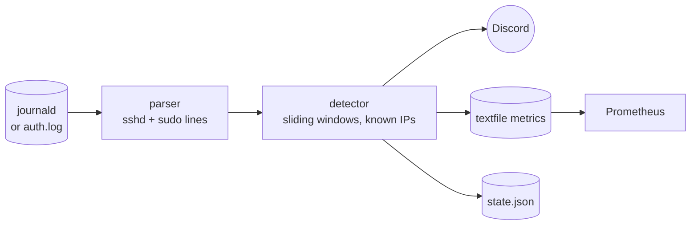

# logwarden

A small intrusion detector for Linux servers. It follows the SSH and sudo logs (journald or `auth.log`),
recognises attack patterns and reports them to Discord and Prometheus.
Pure Python standard library, nothing to install besides Python 3.11+.



## Detection rules

| Rule | Severity | Fires when |
|---|---|---|
| `bruteforce` | warning | ≥ 5 failed logins from one IP within 10 minutes |
| `success_after_failures` | **critical** | a login succeeds from an IP that just failed ≥ 3 times (a guessed password) |
| `new_source_ip` | info | a user logs in from an address never seen for that user before |
| `sudo_failed` | warning | wrong sudo password |
| `sudo` | info | every sudo command (off by default) |

All thresholds, the alert cooldown and ignored networks (e.g. your LAN) are set in `config.toml`.

## Try it

```console
$ make scan
{"rule": "bruteforce", "severity": "warning", "ip": "203.0.113.50",
 "message": "5 failed SSH logins from 203.0.113.50 in 10 min (last user: minecraft)", ...}
{"rule": "success_after_failures", "severity": "critical", "ip": "198.51.100.7",
 "message": "ops logged in from 198.51.100.7 after 3 failed attempts, possibly a guessed password", ...}
```

`--scan` analyses any existing log file once, which is also handy after an incident.

## Install

```bash
sudo ./install.sh            # venv in /opt, system user, hardened systemd unit
sudo $EDITOR /etc/logwarden/config.toml
journalctl -u logwarden -f
```

## Tests

22 pytest tests cover the parser (syslog and ISO timestamps, IPv6, journald messages, year rollover),
every detection rule including windows and cooldowns, log rotation while following a file,
atomic metric writes and the Discord payload. CI runs them on Python 3.11, 3.12 and 3.13 with `ruff`.

## Design decisions

- **Logic without I/O.** The detector only receives events and returns alerts, so every rule is testable with plain data, no log files or network needed.
- **No double counting.** sshd logs `Invalid user X` *and* `Failed password for invalid user X` for the same attempt; only the first is counted, otherwise thresholds would trigger at half the real number.
- **Attackers control the input.** Usernames end up in Discord messages, so mentions are disabled (`allowed_mentions: []`), so a username like `@everyone` can't ping the server.
- **Survives log rotation** like `tail -F` (inode and size check), and the systemd unit runs as an unprivileged user that can read logs but nothing else.
- **Complements, doesn't replace, fail2ban** from [bastion](https://github.com/antony-bdc/bastion): fail2ban blocks, logwarden explains what happened and catches the logins that *succeeded*.

---

Part of my homelab series → [bastion](https://github.com/antony-bdc/bastion) · [observatory](https://github.com/antony-bdc/observatory)
